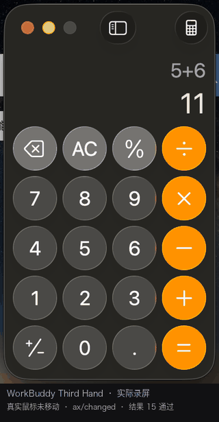

# 🖐️ WorkBuddy Third Hand

### The Third Hand for WorkBuddy

**让 WorkBuddy 拥有第三只手。**

WorkBuddy 的 macOS 原生桌面操作技能与执行引擎——让 WorkBuddy 能够观察、理解并操作桌面应用，在尽可能不打断用户工作的情况下完成真实任务。

> **WorkBuddy 负责思考和决策，Third Hand 负责观察、执行和验证。**

> **Your hands are yours. The third hand belongs to WorkBuddy.**
>
> 你的双手负责自己的工作，第三只手交给 WorkBuddy。

> 🚧 **状态：Experimental（v0.3.0）**
>
> 后台交互能力随 macOS 版本、应用框架与系统授权而不同。
> **已实测范围见 [`docs/capability-matrix.md`](docs/capability-matrix.md)，未测试的一律标 `Not Tested`，不当作「支持」。**



> 上图为**实际运行录屏**（`scripts/record-demo.sh`，只截目标窗口区域，不含用户其他窗口）。
> 紫色光标是 Third Hand 的独立虚拟鼠标，绿色标签是动作反馈，最后显示 `7+8 = 15`。
>
> 为让画面可见，这次录制**临时把目标窗口置前**了——所以这张图不用于证明"不抢前台"。
> 真实鼠标坐标在同一次运行中签名前后一致（878,94 → 878,94）；
> 「不移动鼠标 / 不切换前台 / 不激活目标」这三条由 `tests/integration/session.sh` 逐项断言，
> 不靠看截图推断。

---

## ✨ 什么是 Third Hand？

**Third Hand 不是另一个 AI Agent。** 它是 WorkBuddy 的一只手：没有自己的目标，不独立接管桌面，
只负责把 WorkBuddy 的决策变成可验证的桌面动作。

WorkBuddy 已经能够理解任务、规划步骤和生成代码，但面对真实 macOS 桌面时，传统自动化方式仍有硬伤：

- 鼠标操作会抢占用户正在使用的光标。
- 自动化点击会导致前台应用切换。
- 被遮挡的应用窗口难以通过普通坐标点击操作。
- 部分应用缺少完整的 Accessibility 支持。
- 仅靠截图和点击无法可靠确认操作是否成功。

Third Hand 用 ScreenCaptureKit、macOS Accessibility、进程级事件投递与独立的软件光标，
逐条解决这些问题：

| 传统自动化 | Third Hand |
|---|---|
| 移动真实鼠标到 (x,y) 再点击 | 把事件**直接投递进目标进程**，带窗口号与窗口局部坐标 |
| 目标窗口必须置顶 | 被完全遮挡也能点（实测指针距目标 553px 仍成功） |
| 全局键盘事件，抢焦点 | `postToPid` 定向投递，不进系统事件流 |
| 光标就是用户的鼠标 | 独立软件光标，与物理鼠标零耦合 |
| 「命令返回 0 就算成功」 | 操作前后对比 AX 指纹，必须看到实际变化 |

## 🎯 核心理念

### One User. Two Hands. One AI Third Hand.

传统桌面自动化：

```text
WorkBuddy 需要点击某个按钮
           ↓
移动用户的真实鼠标
           ↓
切换窗口、执行点击
           ↓
用户的操作被打断
```

Third Hand 的目标：

```text
用户                           WorkBuddy
 │                                │
 ├─ 使用真实鼠标                  ├─ 观察目标窗口
 ├─ 使用键盘                      ├─ 识别 UI 元素
 ├─ 继续自己的工作                ├─ 移动独立虚拟光标
 │                                ├─ 执行后台操作
 │                                └─ 验证任务结果
 ▼                                ▼
用户正常工作                  AI 辅助完成任务
```

两个工作流尽可能保持独立。

**Third Hand 的目标不是夺走用户的控制权，而是为 WorkBuddy 增加独立的操作能力。**

---

## 🚀 核心能力

### 🖱️ 1. Independent Ghost Cursor

**一只属于 WorkBuddy 的独立虚拟鼠标。**

- 独立逻辑坐标，锚定 `windowId + 窗口局部坐标`（窗口移动时 100ms 周期重算跟随）
- 透明 Overlay，`ignoresMouseEvents = true` 事件全穿透；`.accessory` 不进 Dock、不抢焦点
- 层级 102：盖得住普通窗口与菜单，不盖系统 HUD / 通知中心
- `easeOutCubic` 0.24s 平滑移动，点击涟漪 + 状态反馈（成功绿环 / 失败红环）
- **不主动移动真实鼠标**，也不读取真实指针位置做「同步」
- 任务结束自动隐藏 / 释放；daemon 崩溃只影响显示，不影响操作

实现：AppKit `NSView.draw(_:)` + 60fps `Timer` 驱动动画，不依赖 Core Animation。

### 🪟 2. Background Window Interaction

**操作其他应用，不一定需要切换到它。**

- **Accessibility 语义操作**（首选）：`AXPress`、`AXValue` 读写——不激活、不需坐标、对遮挡免疫
- **目标进程事件投递**：`postToPid` + 窗口号（事件字段 51）+ 窗口局部坐标
- **窗口坐标转换**：屏幕 ↔ 窗口局部，单一实现，含副屏负坐标
- **窗口捕获与视觉定位**：`SCContentFilter(desktopIndependentWindow:)`
- **操作结果验证**：AX 指纹前后对比

实测：指针距目标 553px、目标 `active=false`、前台不变，点击仍然生效。

### 👁️ 3. Native Window Perception

**看见应用，而不是盲目点击。**

- 发现目标应用与窗口，自动排除系统附属窗（含窗口共享指示器陷阱）
- 捕获指定窗口画面（单帧 / 持续流），Retina 按 `pointPixelScale` 换算
- 读取 AX 树，识别按钮、输入框、菜单及其 `identifier`
- 按坐标在**目标应用自己的树里**定位可按下元素（不用系统级 hit-test，遮挡时它会返回遮挡者）
- 操作后回读实际状态

### 🧠 4. WorkBuddy Skill Integration

**无需每次重新发明桌面操作能力。**

Skill 负责策略与路由，引擎负责执行，两者分离：

- 能用 Accessibility → 优先语义操作
- 需要视觉定位 → 结合窗口捕获
- 需要后台点击 → 用经过验证的定向投递
- 无法安全后台操作 → **明确告知用户并请求授权**，不偷偷降级到全局鼠标

### ✅ 5. Observe → Act → Verify

**点击发生了，不代表任务完成了。**

```text
Observe → Locate → Choose Action → Execute → Verify
                                      ├── changed              → 继续
                                      ├── no_observable_change → 读值确认，不宣称完成
                                      └── 失败                 → 诊断 / 报告原因
```

- 操作前确认目标窗口与元素
- 操作时选择合适通道（语义 → 定向 → 全局，逐级需要更多授权）
- 操作后验证 UI 是否发生预期变化
- **不把「事件投递成功」当作「任务成功」**
- **不在 AX 成功但界面无变化时补投一次坐标点击**——那会让「复制 / 发送 / +」这类非幂等按钮重复执行

---

## 🏗️ 工作原理

```text
              ┌─────────────────────┐
              │      WorkBuddy      │
              │  Think & Decide     │
              └──────────┬──────────┘
                         │
              ┌──────────▼──────────┐
              │  Third Hand Skill   │
              │  Strategy & Routing │
              └──────────┬──────────┘
                         │
              ┌──────────▼──────────┐
              │   Session Manager   │  ← 状态落盘，命令间复用
              └──────────┬──────────┘
                         │
          ┌──────────────┼──────────────┐
          │              │              │
   ScreenCaptureKit  Accessibility  Input Dispatcher
          │              │              │
    Window Capture   UI Elements    Background Input
          │              │              │
          └──────────────┼──────────────┘
                         │
                  Target Application
                         │
                  Result Verification

         Independent Ghost Cursor Overlay
              (Visual Feedback Only · 独立进程)
```

### 技术组成

| 组件 | 职责 | 源码 |
|---|---|---|
| Third Hand Skill | WorkBuddy 技能触发与操作策略 | `skills/workbuddy-third-hand/` |
| Session Manager | 应用绑定、权限闸门、状态与资源管理 | `src/SessionManager/` |
| Window Capture | ScreenCaptureKit 窗口画面捕获 | `src/WindowCapture/` |
| UI Resolver | Accessibility 元素读取与目标定位 | `src/Accessibility/` |
| Input Dispatcher | 选择并执行实际输入操作 | `src/InputDispatcher/` |
| Ghost Cursor | 独立虚拟光标的视觉展示（独立 daemon） | `src/GhostCursor/` |
| Action Verifier | AX 指纹对比，验证操作是否真正生效 | `src/InputDispatcher/Targeted.swift` |

**ScreenCaptureKit 负责观察，Ghost Cursor 负责可视化，Input Dispatcher 负责真正的交互。**
三者独立协作，不能相互替代：关掉光标不影响操作，截图失败不影响投递，投递失败要如实报错。

## 💡 使用场景

### 场景一：工作时让 WorkBuddy 操作其他应用

> 帮我在后台打开计算器，算一下这些数，不要移动我的鼠标。

Third Hand 定位应用、执行可支持的后台操作并验证结果。用户的鼠标与前台窗口不变。

### 场景二：跨应用桌面自动化

> 读取指定应用中的数据，整理后填入另一个应用的表格。

观察窗口状态、识别目标控件、执行授权操作，每步读值确认。

### 场景三：复杂 GUI 操作

> 找到这个窗口中的设置选项，完成修改，然后检查是否生效。

优先 Accessibility 语义操作，必要时结合视觉定位与已验证的后台输入方式。

### 场景四：持续运行的桌面工作流

> 处理目标应用中的重复任务，并在每一步确认结果。

统一会话管理 + 每步验证，降低误操作与状态失控风险。

---

## 📦 安装

本项目由两部分组成：

1. **Third Hand Skill** —— 教会 WorkBuddy 识别适用场景、调用工具、处理异常
2. **Third Hand Native Engine**（二进制名 `wbcu`）—— 窗口捕获、界面识别、后台交互、虚拟光标

**仅安装 Skill 文档不能替代原生执行模块。**

### 环境要求

- macOS 14 或更高（部署目标 14.0；**实测于 macOS 26.6**）
- Xcode Command Line Tools（`xcode-select --install`）
- 无需 Homebrew，无第三方依赖
- 按需授予 **辅助功能** / **屏幕录制**；仅当必须动真实鼠标时才需要 **输入注入**

### 获取与安装

```bash
git clone https://github.com/1791986214/macos-background-computer-use.git
cd macos-background-computer-use

./scripts/build.sh                 # 编译原生引擎 → bin/wbcu
./scripts/install.sh --skill       # 装引擎 + Skill
wbcu selftest                      # 27 项纯逻辑自检，不需要任何系统授权
```

安装后各部件落位：

| 内容 | 路径 |
|---|---|
| 原生引擎 | `~/.local/bin/wbcu` |
| MCP 服务器 | `~/.local/share/wbcu/wbcu-mcp.mjs` + 启动器 `~/.local/bin/wbcu-mcp` |
| **Skill（用户级，跨项目可用）** | `~/.workbuddy/skills/workbuddy-third-hand/` |
| 运行时状态 | `~/.wbcu/`（授权白名单、会话、快照） |

> 仓库 slug 仍是 `macos-background-computer-use`，产品名是 **Third Hand**，二进制名仍是 `wbcu`。
> 保留这两者是为了不打断已有克隆、脚本与 MCP 配置里的调用路径。

### 接入 WorkBuddy

**方式一：Skill（推荐）**

```bash
./scripts/install.sh --skill      # 等价于下面两步
# mkdir -p ~/.workbuddy/skills
# cp -R skills/workbuddy-third-hand ~/.workbuddy/skills/
```

装好后 WorkBuddy 在遇到「帮我操作另一个应用 / 不要动我的鼠标 / 读一下那个窗口」这类任务时
会自动加载该技能。

**方式二：MCP 工具**（`~/.workbuddy/mcp.json`）

```json
{
  "mcpServers": {
    "wbcu": {
      "command": "<HOME>/.local/bin/wbcu-mcp",
      "args": [],
      "env": { "WBCU_BIN": "<HOME>/.local/bin/wbcu" }
    }
  }
}
```

> MCP 不会自动生效：需在 WorkBuddy 连接器管理页右上角「自定义连接器」点「信任」。

### WorkBuddy 调用示例

Agent 侧一次完整后台操作（MCP 工具 `cu_session`）：

```jsonc
// 1) 建会话：解析主窗口 + 检查授权
{"action": "start", "app": "com.apple.calculator"}
// → {"ok": true, "session": {"id": "s12345", "windowId": 857, "pid": 62008, ...}}

// 2) 看界面（先读 AX 树，便宜且精确）
{"action": "inspect", "session_id": "s12345", "max_nodes": 40}

// 3) 按文本语义点击（不激活、不需坐标、遮挡也能点）
{"action": "click", "session_id": "s12345", "text": "7", "exact": true, "label": "7"}

// 4) 读值验证，而不是读 ok
{"action": "verify", "session_id": "s12345", "expect": "15"}
// → {"matched": true, "ok": true, "values": ["7+8", "15"]}

// 5) 收尾释放
{"action": "end", "session_id": "s12345"}
```

命令行等价（`wbcu session ...`），两者指向同一个引擎：

```bash
SID=$(wbcu session start --app com.apple.calculator --json \
      | python3 -c "import sys,json;print(json.load(sys.stdin)['session']['id'])")
wbcu session click  --id "$SID" --text "7" --exact
wbcu session verify --id "$SID" --expect "15"
wbcu session end    --id "$SID"
```

### 授权

```bash
wbcu perm --prompt                               # 触发系统授权弹窗
wbcu guard --app com.apple.calculator --allow     # 按应用授权（第二道闸门）
```

### macOS 权限

| 权限 | 用途 | 缺失后果 |
|---|---|---|
| Accessibility | 读 AX 树、语义操作、写 AXValue | 无法操作，只剩截图 |
| Screen Recording | ScreenCaptureKit 窗口捕获 | 无法捕获，AX 操作照常 |
| PostEvent | 全局 HID（仅 `--allow-global`） | 全局点击不可用，定向投递不受影响 |

本项目**不绕过** macOS TCC：不写 TCC 数据库、不伪造签名、不提权。
完整说明（含 TCC 归因到「责任进程」这个坑）：[`docs/permissions.md`](docs/permissions.md)。
升级 / 卸载 / 换机恢复：[`docs/installation.md`](docs/installation.md)。

## ⚡ 性能与经验记忆（2.0）

### 同一台机器、同一套动作的 A/B

Calculator，同样 5 步操作 × 6 轮 = 30 次点击，端到端墙钟（含一次进程启动）：

| 版本 | P50 | P95 | 做法 |
|---|---|---|---|
| v0.3.0 | 995 ms | 1019 ms | 每步固定 `usleep` 700ms，每次全树遍历两次 |
| **v0.4.0** | **108 ms** | **124 ms** | 去掉固定睡眠、光标解耦、经验命中、单次验证 |

**P50 −89%，P95 −88%。**

### 时间到底花在哪（先测再改）

改造前一次点击的固定开销：

```
等光标动画走完   260 ms   ← 纯视觉，却在关键路径上
点击后空等       200 ms   ← 只为「让它反应一下」
验证前空等       240 ms   ← 然后还整树扫了一遍
```

合计 ~700ms/步。**截图不是瓶颈**（单帧 60–80ms，且操作路径根本不依赖截图），
所以没有去做「提高截图帧率」这种优化 —— 那是猜出来的方向。

### 四个改动

1. **光标与输入解耦**：`fast` 模式先投递、动画并行；`normal` 短暂起势；`demo` 保留完整动画供演示。
   视觉层永远不阻塞执行层。
2. **经验命中取代整树遍历**：第二次点同一个按钮时，按 AX 路径 `O(深度)` 回查并校验身份，
   不再扫全树。详见 [`docs/experience-memory.md`](docs/experience-memory.md)。
3. **验证从两次扫描降到一次**：会话里保存上一次的整树指纹作基线，操作后只扫一次即可判断「别处有没有变」。
4. **事件驱动验证（AXObserver）实现并保留，但默认关闭**：
   实测在 Calculator 上学到的观测元素常落在「上个表达式」上，普通按键不会让它变化，
   必然超时 400ms；而单次指纹遍历只要 ~10ms。**在这里它是负收益**，所以默认走指纹，
   需要时用 `--observe-watch` 显式开启。这个结论来自实测，不是没做。

### 经验库的收益有多大（不夸大）

引擎内部耗时，按经验状态分组（同一批 36 次点击）：

| 状态 | P50 | 说明 |
|---|---|---|
| 冷启动冷路径 | 109.7 ms | 首次，整树遍历 |
| 未命中 | 90.8 ms | 有库但校验失败，回退遍历 |
| **命中** | **76.9 ms** | 路径回查 + 校验 |

命中相对未命中省约 15%。**主要收益来自去掉固定睡眠，不是经验库**；
AX 树越大、层级越深的界面（Electron / 复杂表单），经验命中的价值才明显放大。
Calculator 树只有 36 个节点，所以空间有限 —— 这是实测，不吹。

### 自己验证

```bash
wbcu bench --app com.apple.calculator --iters 5 --cold   # 冷启动基准（清空经验）
wbcu bench --app com.apple.calculator --iters 5          # 复用经验
wbcu perf stats                                          # 按冷/未命中/命中分组对比
wbcu experience list --app com.apple.calculator          # 看学到了什么
```

`bench` 会同时校验**零干扰**：真实鼠标位移、前台是否切换，并用 `wbcu idle`
判断期间有没有人真的在操作 —— 有人在动就标记为「结论不可用」，不把用户的动作算成引擎的锅。

## 🧪 可靠性与兼容性

Third Hand 追求**可靠、可验证**的后台操作，而不是声称所有 macOS 应用都能完全无干扰控制。

实测结论（macOS 26.6，目标窗口被完全遮挡）：

| 目标 | AX 语义 | 进程级投递 | 备注 |
|---|---|---|---|
| Calculator（AppKit 标准控件） | ✅ | ✅ | `7+8=15`、`6×7=42` 读值验证通过 |
| 自绘 `NSView` | ❌ 无 AXPress | ✅ | 需目标视图 `acceptsFirstMouse=true`（第三方 App 改不了） |
| `WKWebView` 内按钮 | ✅ | ❌ | 走 `AXWebArea → AXButton` |
| TextEdit 文本框 | ✅ `AXValue` | ❌ 按键 | 非激活窗口无 field editor |
| 拖拽 | — | ⚠️ | `mouseDown` 送达，AppKit 不建立拖拽会话 |
| Electron / Chromium | `Not Tested` | `Not Tested` | 需真实 Electron App + `AXManualAccessibility` |
| 多显示器 | `Not Tested` | `Not Tested` | 仅有负坐标换算的单测 |
| macOS 27 | `Not Tested` | `Not Tested` | 本机只有 SDK，没有 27 系统 |

事件投递路径实测（同一窗口、完全遮挡、指针距目标 553px）：

| 投递方式 | 结果 |
|---|---|
| 裸 `postToPid` | 0/3 |
| `postToPid` + 窗口号（字段 51） | 0/3 |
| `postToPid` + 51 + 字段 58 | **3/3** |
| `postToPid` + 51 + `CGEventSetWindowLocation` | **3/3** |
| AX `AXPress` | **3/3** |

**未经测试的能力不标记为已支持。** 完整矩阵：[`docs/capability-matrix.md`](docs/capability-matrix.md)。

> **可靠的第三只手，首先应该知道自己什么时候能操作，什么时候不能。**

测试分层：

```bash
./tests/run-all.sh unit     # 纯逻辑 + 源码卫生，无 GUI / 无授权，CI 每次跑
./tests/run-all.sh          # 再加会话层集成测试（需授权与真实桌面）
./tests/run-all.sh all      # 再加历史回归矩阵与 fixture 对照
```

**CI 绿不等于功能可用。** 托管 runner 没有图形会话、无法人工授权、也无法保证没人动鼠标，
所以真实交互测试只在授权机器上跑。这条原则写在 `.github/workflows/ci.yml` 的注释里。

## 🔐 安全与隐私

- **不绕过系统权限**：只走系统允许的授权流程。
- **不默认接管真实鼠标**：全局 HID 必须显式 `--allow-global`，且要先得到用户同意。
- **不静默执行高风险操作**：删除、发送、提交、支付由 Skill 层硬规则拦截，先确认再动。
- **不默认上传桌面截图**：截图、AX 树、会话状态全部留在本地 `~/.wbcu/`。
- **不收集或提交个人凭据**：仓库有源码卫生检查（密钥 / 个人路径 / 私有 API）。
- **失败保留可诊断信息**：结构化错误码，不吞异常。
- **任务取消后释放资源**：`session end` 关闭会话并隐藏光标。

已知的未文档化依赖及缓解方案见 [`SECURITY.md`](SECURITY.md)。
**SkyLight / SLS / SLPS 完全未使用。**

## 🗺️ Roadmap

### Phase 1 — Third Hand Foundation
- [x] WorkBuddy Skill 标准化（用户级技能，跨项目可见）
- [x] 原生执行引擎封装（CLI 会话层 + MCP 16 工具）
- [x] Ghost Cursor 生命周期管理
- [x] 后台点击结果验证（AX 指纹三态）
- [x] Calculator / TextEdit 基础测试

### Phase 2 — Reliable Automation
- [x] 多窗口 / 多应用会话管理（按 id 隔离）
- [x] Retina 适配（`pointPixelScale` 换算）
- [ ] 多显示器实机坐标映射（当前只有负坐标换算单测）
- [ ] 更完整的应用兼容测试
- [x] 失败诊断（结构化错误码）与基础恢复
- [x] 自动化回归测试（单元 / 集成 / 回归三层）

### Phase 3 — Advanced Computer Use
- [ ] Electron / Chromium 兼容性优化（`AXManualAccessibility` 路径）
- [ ] 更复杂的输入与拖拽研究（当前公开 API 实现不了；私有 SkyLight 方案**未集成**）
- [ ] 跨应用工作流编排
- [ ] 完善的使用记录与调试工具
- [x] 长期版本维护与发布机制（分支 → PR → CI → Release → 同步技能）

完成状态按真实实现与测试结果更新，不预先打勾。

## 🔄 长期维护

Third Hand 不应该只是一次成功的实验。每次新增或改进能力，都遵循：

```text
Research → Implement → Test → Verify
                           ↓
                 Update Skill & Docs
                           ↓
                    Commit & PR
                           ↓
                    Release & Sync
```

通过 GitHub 保存源码、技能说明、回归测试与版本记录，让新会话、新项目、新工作流
都能复用已经验证的能力。

## 📚 技术参考

- [Apple ScreenCaptureKit](https://developer.apple.com/documentation/screencapturekit/)
- [Apple Accessibility APIs](https://developer.apple.com/documentation/applicationservices)
- [agent-device](https://github.com/callstack/agent-device)
- [OpenAI Codex](https://github.com/openai/codex)

Third Hand 是面向 WorkBuddy 的独立工具项目，**不包含**上述项目的内部或专有代码，
也不代表它们的官方实现。

## 🤝 参与贡献

欢迎 Issue、兼容性测试报告与 PR。提交问题时请附：macOS 版本、目标应用与框架类型、
最小复现步骤、**界面实际发生了什么**（这条最关键）、脱敏后的 `wbcu capabilities --json`。

流程与代码约定见 [`CONTRIBUTING.md`](CONTRIBUTING.md)。

## 📄 License

[MIT](LICENSE)。

仓库内无第三方代码、无外部依赖（MCP 服务器为手写零依赖脚本）。唯一涉及的外部技术依赖是
Apple 系统 API 与一个未文档化符号 `_AXUIElementGetWindow`，该符号不属于可再分发代码。

---

## 🖐️ Give WorkBuddy a Third Hand

**WorkBuddy can think. Third Hand helps it act.**

让 WorkBuddy 不止能够思考、规划和回答。
让它拥有一只真正能够观察桌面、操作应用、验证结果，并尽可能与你并行工作的第三只手。

**Your hands stay in control. WorkBuddy gets a Third Hand.**
