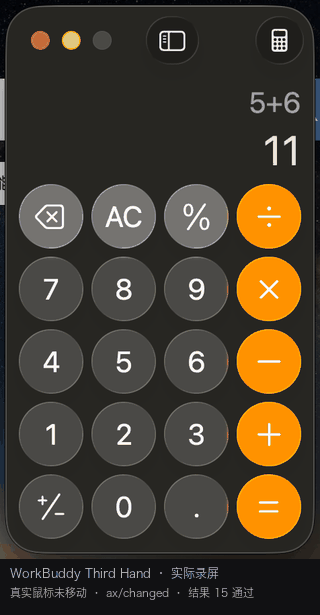
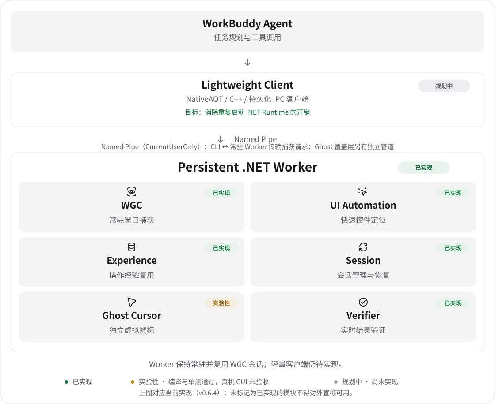
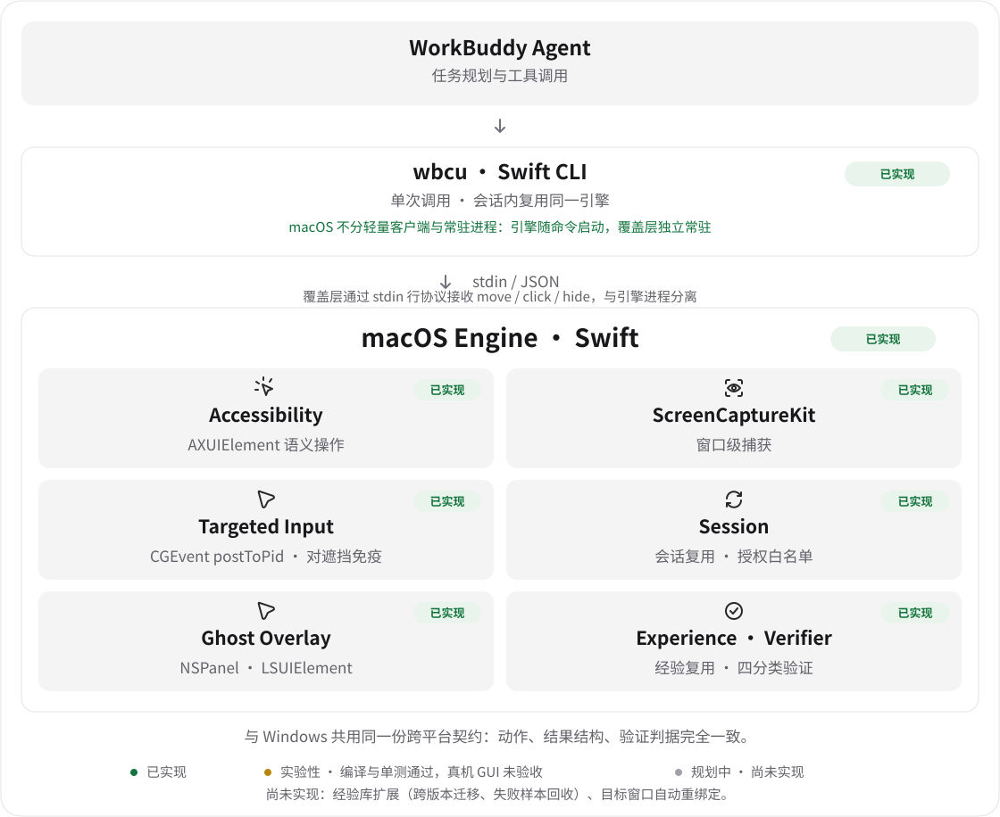

<div align="center">

# Third Hand

**WorkBuddy can think. Third Hand helps it act.**

WorkBuddy 的第三只手 —— 持续感知、精准操作、后台执行、经验学习。

<sub>macOS v0.6.2 · Windows v0.6.4　│　Native desktop automation for agents</sub>

</div>

---

## 它是什么

Third Hand 是 WorkBuddy 的桌面执行引擎。WorkBuddy 负责思考与决策，Third Hand 负责**看见界面、点准控件、验证结果**——并且尽量不打断你手上的工作。

它不是 RPA。它优先走**语义通道**（macOS Accessibility / Windows UI Automation），只有在控件不提供语义时才降级到定向输入，最后才是全局注入——而全局注入必须显式授权。

它也不假装成功。每次操作都会读回目标状态，给出四分类结论：

| 结果 | 含义 | 能否说「做完了」 |
|---|---|---|
| `success` | 确认产生了预期结果 | 可以 |
| `already_satisfied` | 操作前就已满足期望 | 只能说「已经是这个状态」 |
| `failure` | 实际与期望不符 | 必须如实说失败 |
| `inconclusive` | 证据不足 | 不能，需要补一个期望值 |

一句话原则：**真实鼠标零位移、前台不切换、键盘焦点不被抢**，同时界面真的变了。

---

## 实际操作演示

<div align="center">

</div>

> 紫色光标是 Third Hand 的独立虚拟鼠标，与系统鼠标无任何关系。
> 这次录制为让画面可见临时把目标窗口置前，因此**不用于证明「不抢前台」**。
> 「不移动鼠标 / 不切换前台 / 不激活目标」由自动化测试逐项断言，见 [兼容性验证](docs/capability-matrix.md)。

---

## 核心能力

**语义优先 · Semantic-first**
按 AutomationId / 控件名 / 控件类型定位，直接调用 UIA Pattern 或 AXPress。不需要坐标，不需要前台，对遮挡免疫。

**后台执行 · Background execution**
不改动前台窗口、不移动真实指针、不抢键盘焦点。所有「零干扰」结论都来自测量，不是声明。

**结果验证 · Verified results**
操作后读回状态并做四分类裁决。`delivered`（事件是否进入目标）与 `verified`（界面是否真的变了）分开上报。

**经验复用 · Experience reuse**
只记忆语义稳定的定位依据（控件标识 / 相对路径 / 名称），不记忆坐标与窗口句柄——它们在进程重启后就会失效。

---

<h2 align="center">Windows Architecture</h2>
<p align="center">

</p>
<p align="center">
<sub>Persistent perception. Precise interaction.
Continuous learning.</sub>
</p>

上图是当前架构，模块状态以图中标记为准：

- **已实现** —— UI Automation、WGC、Session、Experience、Verifier、Persistent Worker。
  - UI Automation 已在 Windows 10 19045 真机验证：记事本后台写入 `success`（`uia_setvalue`，0.95），读回一致，`frontAppPreserved` 与 `physicalCursorPreserved` 均为 `true`。
  - WGC（Windows Graphics Capture）已通过真机验收矩阵：完全可见 / 部分遮挡 / 四周外扩完全遮挡 / 连续切前台 / 移动 / 缩放 / 最小化，用「同一场景连续两帧不同」判定是否为实时画面。
  - 常驻 Worker 经 Named Pipe（`CurrentUserOnly`）复用 WGC 会话与帧池，抵消 CLI 每次 750–1180 ms 的 .NET 冷启动。
- **实验性** —— Ghost Cursor。渲染与窗口属性已核对，DWM 合成观感待验收。
- **规划中** —— Lightweight Client（NativeAOT / C++，目标是把 CLI 冷启动也消掉）、经验库扩展、目标窗口自动重绑定。

细节见 [Windows 架构](docs/windows-architecture.md) 与 [Windows 能力矩阵](docs/windows-capability-matrix.md)。

---

<h2 align="center">macOS Architecture</h2>
<p align="center">

</p>
<p align="center">
<sub>Native frameworks, no IPC overhead.
Same semantics as Windows.</sub>
</p>

macOS 侧不拆分轻量客户端与常驻进程：引擎随命令启动，覆盖层是独立的 `LSUIElement` 进程。语义通道是 Accessibility（`AXUIElement`），捕获用 ScreenCaptureKit，定向输入用 `CGEvent postToPid`（带窗口上下文，因此对遮挡免疫）。

两个平台共享同一份 [跨平台契约](contract/README.md)：动作名、结果结构、验证判据、经验格式完全一致，差异只在底层实现。

---

## 安装与使用

<div align="center">
<sub>一条命令装好引擎与 WorkBuddy 技能</sub>
</div>

**npm（Windows / macOS，需 Node 18+）**

```bash
npm i -g https://github.com/1791986214/macos-background-computer-use/releases/download/v0.6.2-rc1/workbuddy-third-hand-0.6.3.tgz
wbcu doctor
```

**PowerShell（Windows，未装 Node）**

```powershell
powershell -ExecutionPolicy Bypass -Command "irm https://github.com/1791986214/macos-background-computer-use/releases/download/v0.6.2-rc1/install-windows.ps1 | iex"
```

**macOS 源码安装**

```bash
git clone https://github.com/1791986214/macos-background-computer-use.git
cd macos-background-computer-use && ./scripts/install.sh --skill
```

**最小工作流**

```bash
wbcu attach --app calc --json            # 建会话（同名自动复用）
wbcu inspect --id <sid> --max 200        # 先看控件树，别急着按坐标
wbcu click --id <sid> --name "7" --expect "15" --state automationid:CalculatorResults
wbcu session end --id <sid>
```

验收只看 `verification.result`。完整命令与退出码见 [命令行参考](references/api.md)，平台差异见 [SKILL.md](skills/workbuddy-third-hand/SKILL.md)。

---

## 性能表现

只列实测值，没有实测的留空。

| 指标 | macOS | Windows |
|---|---|---|
| 单次点击（命中经验） | 77 ms | 未实测 |
| 单次点击（冷启动，首次解析） | 110 ms | 未实测 |
| CLI 冷启动（每次调用） | — | 750–1180 ms（Worker 已可绕开） |
| 窗口截图（WGC 命中会话） | ScreenCaptureKit 持续流 | 约 210 ms |
| 窗口截图（PrintWindow 兜底） | — | 21.5 ms（992×624） |
| 虚拟光标渲染 | — | 4.77 ms/帧 @252 px（60 fps） |
| 覆盖层静态开销 | — | 静止不重绘（脏标记） |

`wbcu perf stats` 输出 P50 / P95，数据来自真实调用记录；`wbcu bench` 可复现 macOS 侧的冷启动与命中差异。

---

## 兼容性

| 维度 | 支持 | 明确不支持 |
|---|---|---|
| 系统 | macOS 14+（Apple Silicon）、Windows 10 22H2 / 11 x64 | Windows 7/8、无交互桌面的 Server 会话 |
| 目标应用 | 原生 Win32、WPF/WinUI、AppKit/Cocoa | 受 DRM 保护内容、最小化窗口截图 |
| 权限边界 | 普通用户即可 | 提权绕过 UIPI / UAC（不做） |
| 网页内容 | 交给 WorkBuddy Browser Use | 不做 Chromium 自动化 |

- macOS 能力矩阵：[docs/capability-matrix.md](docs/capability-matrix.md)
- Windows 能力矩阵：[docs/windows-capability-matrix.md](docs/windows-capability-matrix.md)
- 真机回执与处置：[docs/receipt-v0.6.0-windows-real-machine.md](docs/receipt-v0.6.0-windows-real-machine.md)

已知限制（如实记录，不美化）：Electron 默认关闭无障碍树时只能退化为窗口消息；自绘界面无 Pattern 时成功率不保证；目标以管理员身份运行时消息会被 UIPI 静默丢弃。

---

## Roadmap

| 方向 | 状态 | 说明 |
|---|---|---|
| Windows GUI 验收套件跑绿 | 进行中 | 套件已就绪，需交互式桌面；全绿后才把 `not_tested` 升级为 `supported` |
| Lightweight Client（NativeAOT / C++） | 规划中 | 常驻 Worker 已落地，剩下的是把 CLI 冷启动 750–1180 ms 也消掉 |
| 经验库扩展 | 规划中 | 跨版本迁移、失败样本回收、按应用版本淘汰 |
| 目标窗口自动重绑定 | 规划中 | 目标重启或换窗口后自动接续会话，而不是报 `session_stale` |
| npm registry 正式发布 | 待授权 | 包已构建并校验，待 npm 账号授权后推送 |

---

<div align="center">
<sub>

Third Hand is a tool sharpener, not a gatekeeper. 不加审批、不加阻塞、不做前台守卫。

[架构](docs/architecture.md) · [安装](docs/installation.md) · [Windows 安装](docs/windows-installation.md) · [跨平台契约](contract/README.md) · [排错](docs/troubleshooting.md)

</sub>
</div>
